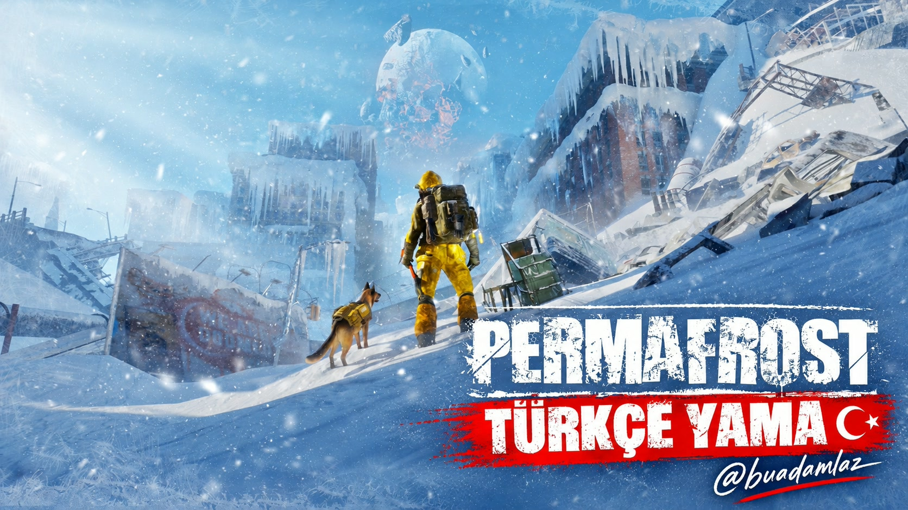
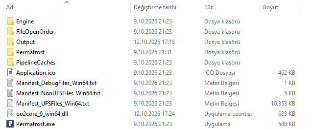
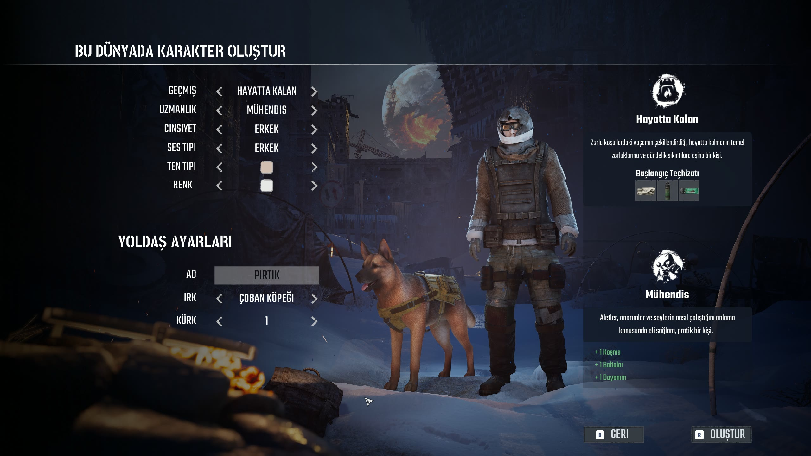

<div align="center">



# ❄️ Permafrost Türkçe Yama 🇹🇷

**Buzul çağında hayatta kalma macerasını artık tamamen Türkçe yaşayın!**

[](#-yama-bilgileri)
[](#-yama-bilgileri)
[](#)

<br>

## 📥 [YAMAYI İNDİRMEK İÇİN TIKLAYIN](https://github.com/buadamlaz/permafrost-turkce-yama/releases/latest/download/Permafrost-Turkce-Yama.zip) 📥

[](https://github.com/buadamlaz/permafrost-turkce-yama/releases/latest/download/Permafrost-Turkce-Yama.zip)

<sub>Bağlantıya tıkladığınızda indirme otomatik olarak başlar. Tüm sürümler için <a href="https://github.com/buadamlaz/permafrost-turkce-yama/releases">Releases</a> sayfasına bakabilirsiniz.</sub>

</div>

---

## 🧊 Oyun Hakkında

**Permafrost**, dünyanın sonsuz bir kışa gömüldüğü, buzlarla kaplı kıyamet sonrası bir dünyada geçen bir **hayatta kalma** oyunudur. 🥶
Dondurucu soğuğa, açlığa ve tehlikelere karşı mücadele edin; kaynak toplayın, sığınak inşa edin ve sadık dostunuzla birlikte bu buzul çağında hayatta kalmaya çalışın. 🐕🔥

Bu yama ile oyundaki menüler, arayüz ve metinler **Türkçe** olarak karşınızda! 🇹🇷

---

## 📋 Yama Bilgileri

| | |
|---|---|
| 🎮 **Oyun** | Permafrost |
| 🔢 **Uyumlu Sürüm** | `v0.44.3.4666` |
| 📅 **Güncelleme Tarihi** | 14.10.2026 |
| 🏷️ **Yama Sürümü** | `v0.44.3.4666-fix1` |
| 🌐 **Dil** | Türkçe |
| 👤 **Geliştirici** | [buadamlaz](https://github.com/buadamlaz) |
| 💬 **Discord** | [@buadamlaz](https://discord.com/users/533736767199903754) |

> ⚠️ **Not:** Yama yalnızca belirtilen oyun sürümü ile test edilmiştir. Oyun güncellendiğinde yamanın da güncellenmesi gerekebilir.

---

## 📜 Değişiklik Günlüğü

### 🔧 `v0.44.3.4666-fix1` — 14.10.2026
> 🎮 Oyun sürümü değişmedi (`v0.44.3.4666`), çeviri hataları giderildi.

- 🛠️ **Eşya üretimi (crafting) seçeneklerinde** yanlış görünen değer çevirileri düzeltildi:

  | ❌ Önce | ✅ Şimdi |
  |:---:|:---:|
  | `Daha İyi 10` | `+10` |
  | `Daha Kötü 10` | `-10` |

### 🎉 `v0.44.3.4666` — 13.10.2026
- 🚀 İlk sürüm yayınlandı.
- 🇹🇷 Menüler, arayüz ve oyun içi metinler Türkçeleştirildi.

> 💡 Güncelleme yaparken yeni zip'i indirip aynı şekilde ana dizine çıkarmanız ve dosyaların üzerine yazmanız yeterlidir.

---

## 🛠️ Kurulum

### 1️⃣ Yamayı indirin
👉 **[Permafrost-Turkce-Yama.zip](https://github.com/buadamlaz/permafrost-turkce-yama/releases/latest/download/Permafrost-Turkce-Yama.zip)** dosyasını indirin.

### 2️⃣ Oyunun kurulu olduğu ana dizini açın
Steam kullanıyorsanız: **Steam ➜ Kütüphane ➜ Permafrost'a sağ tıklayın ➜ Yönet ➜ Yerel dosyalara göz at**

Açılan klasör, içinde `Permafrost.exe` dosyasının bulunduğu **oyun ana dizini**dir:

<div align="center">

</div>

### 3️⃣ Zip içindeki klasörü ana dizine çıkarın
Zip dosyasının içindeki **`Permafrost`** klasörünü, yukarıdaki görselde görülen **oyunun ana dizinine** çıkarın / kopyalayın.
Dosyaların üzerine yazılması sorulursa **"Evet"** / **"Dosyaları değiştir"** deyin. ✅

Doğru yaptıysanız dosyalar şu konumlarda olmalıdır:

```
📁 Oyun Ana Dizini
 ├── 📄 Permafrost.exe
 └── 📁 Permafrost
      └── 📁 Content
           ├── 📁 Paks
           │    └── 📁 ~mods
           │         └── 📦 zz_Turkce_P.pak
           └── 📁 Splash
                └── 🖼️ Splash.bmp
```

### 4️⃣ Oyunu başlatın 🎉
Oyunu açın ve Türkçe'nin keyfini çıkarın! ❄️🔥

---

## 🗑️ Kaldırma

Yamayı kaldırmak için şu dosyayı silmeniz yeterlidir:

```
Permafrost\Content\Paks\~mods\zz_Turkce_P.pak
```

---

## ❓ Sık Sorulan Sorular

<details>
<summary>🔸 <b>Oyun hâlâ İngilizce görünüyor, ne yapmalıyım?</b></summary>
<br>
Zip içindeki <code>Permafrost</code> klasörünü <b>oyunun ana dizinine</b> (içinde <code>Permafrost.exe</code> bulunan klasör) çıkardığınızdan emin olun. Klasörü yanlışlıkla iç içe (<code>Permafrost\Permafrost\...</code>) kopyalamadığınızı kontrol edin.
</details>

<details>
<summary>🔸 <b>Oyun güncellendi, yama çalışmıyor.</b></summary>
<br>
Yama <code>v0.44.3.4666</code> sürümü için hazırlanmıştır. Yeni sürümler için bu sayfayı takip edin. ⭐ vererek güncellemelerden haberdar olabilirsiniz.
</details>

<details>
<summary>🔸 <b>İndirme bağlantısı çalışmıyor.</b></summary>
<br>
Sağ taraftaki <a href="https://github.com/buadamlaz/permafrost-turkce-yama/releases"><b>Releases</b></a> bölümünden en son sürümü açıp <b>Assets</b> altındaki <code>.zip</code> dosyasına tıklayarak da indirebilirsiniz.
</details>

---

## 💬 Hata Bildirimi & Öneriler

Çeviride bir hata mı buldunuz ya da bir öneriniz mi var? 📝
[**Issues**](https://github.com/buadamlaz/permafrost-turkce-yama/issues) bölümünden bildirebilir ya da bana **Discord** üzerinden ulaşabilirsiniz. Her geri bildirim yamanın daha iyi olmasına katkı sağlar! 🙏

<div align="center">

[](https://github.com/buadamlaz/permafrost-turkce-yama/issues)
[](https://discord.com/users/533736767199903754)

</div>

Yamayı beğendiyseniz sayfanın sağ üstündeki **⭐ Star** butonuna tıklamayı unutmayın!

---

## 📸 Oyun İçi Ekran Görüntüsü

<div align="center">


<br><br>

**❄️ İyi oyunlar, hayatta kalmaya çalışın! ❄️**

<sub>Bu yama hayran yapımıdır ve resmi değildir. Permafrost ve ilgili tüm haklar sahiplerine aittir.</sub>

</div>
